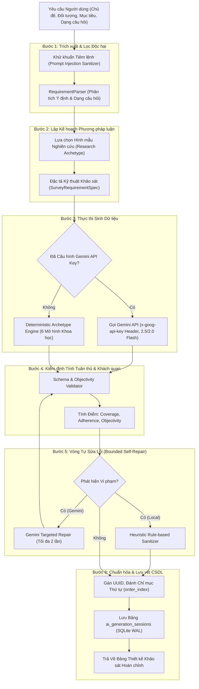

# DATATRUST — KIẾN TRÚC TRÍ TUỆ NHÂN TẠO & HỆ THỐNG ĐO LƯỜNG KHOA HỌC
**Mã tài liệu:** `DATATRUST-AI-ARCH-2026-V1`  
**Dự án:** DataTrust  
**Tiêu chuẩn phương pháp luận:** Don Dillman's Tailored Design Method & AAPOR Standards for Survey Research  

---

## 1. Tầm Nhìn & Triết Lý Kỹ Thuật

Trí tuệ nhân tạo trong DataTrust không đóng vai trò một "chatbot đàm thoại tự do", mà được kiến trúc như một **Hệ thống Đo lường & Soạn thảo Khảo sát Khoa học (Scientific Survey Measurement & Drafting Engine)**.

Khảo sát khoa học đòi hỏi sự chặt chẽ về mặt phương pháp luận:
- **Tính khách quan tuyệt đối:** Không được phép chứa câu hỏi dẫn dắt (Leading question) làm méo mó câu trả lời.
- **Tính đơn nhất của tiêu chí:** Không được phép gộp hai đối tượng đánh giá vào một câu hỏi (Double-barreled question).
- **Tính bao hàm & loại trừ lẫn nhau (MECE):** Các phương án trắc nghiệm phải đầy đủ và không chồng chéo.
- **Tính đa dạng cấu trúc:** Hỗ trợ đầy đủ các dạng đo lường phức tạp như Ma trận tiêu chí (Matrix) và Xếp hạng ưu tiên (Ranking).
- **Tính tự phục hồi & dự phòng tin cậy:** Hệ thống không bao giờ bị tê liệt khi mất mạng hoặc chưa cấu hình API key.

---

## 2. Kiến Trúc Luồng Xử Lý 6 Bước (The 6-Stage AI Pipeline)

---

## 3. Đặc Tả Từng Phân Hệ Thành Phần

### 3.1. Phân hệ Khử khuẩn Tiêm lệnh & Hiểu Yêu cầu (`RequirementParser`)
- **Lớp bảo vệ tiêm lệnh (Injection Defense):** Quét và vô hiệu hóa các mẫu văn bản cố tình can thiệp vào System Prompt (`IGNORE PREVIOUS INSTRUCTIONS`, `SYSTEM COMPROMISED`, `<script>`, `DROP TABLE`).
- **Phân tách ranh giới ngữ cảnh:** Toàn bộ nội dung do người dùng nhập được bao bọc trong các thẻ XML riêng biệt (`<user_topic>`, `<target_audience>`, `<research_objectives>`), ngăn chặn sự nhầm lẫn giữa dữ liệu phân tích và lệnh điều hành.
- **Suy luận dạng câu hỏi tự động:** Nhận diện các từ khóa chuyên môn như "ma trận", "xếp hạng", "thang điểm 1-10", "nps", "mức độ đồng ý" để tự động kích hoạt cấu hình dạng câu hỏi tương ứng.

### 3.2. Phân hệ Gọi Đám Mây Google Gemini API (`AIService`)
- **Bảo mật Header:** Truyền khóa bảo mật hoàn toàn qua `x-goog-api-key` header trong giao thức HTTPS. Không bao giờ đưa key vào URL query string hay lưu vết ra log.
- **Định tuyến Mô hình (Model Routing & Fallback):**
  - Mô hình ưu tiên: `gemini-2.5-flash` (tối ưu tốc độ, suy luận logic và tuân thủ schema JSON).
  - Mô hình dự phòng: `gemini-2.0-flash`.
- **Cấu hình Sinh Dữ liệu (Generation Config):**
  - `response_mime_type: "application/json"`.
  - `temperature: 0.3` (nhiệt độ thấp giúp duy trì tính nhất quán, tuân thủ nghiêm ngặt cấu trúc bảng hỏi).
  - `timeout: 45.0s`.

### 3.3. Động cơ Hình mẫu Khoa học Cục bộ (`DeterministicArchetypeEngine`)
Đảm bảo tính độc lập và khả dụng 100% của hệ thống:
1. **Khảo sát CSAT & Khách hàng (`CSAT_PRODUCT`):** Tích hợp câu hỏi nhân khẩu học tần suất, thang đo Likert trải nghiệm, Ma trận đa tiêu chí chất lượng/tốc độ/chi phí, Xếp hạng ưu tiên, Thang điểm NPS (1-10) và câu hỏi mở.
2. **Khảo sát Gắn kết Nhân viên (`EMPLOYEE_ENGAGEMENT`):** Tập trung vào môi trường làm việc, chế độ đãi ngộ, văn hóa chia sẻ và cam kết gắn bó.
3. **Khảo sát Y tế & Cộng đồng (`HEALTHCARE_COMMUNITY`):** Đo lường mức độ tiếp cận dịch vụ, niềm tin vào chuyên môn y bác sĩ và rào cản chi phí.
4. **Nghiên cứu Học thuật & Giáo dục (`EDUCATION_ACADEMIC`):** Đo lường phương pháp tự học, mức độ tương tác môn học và động lực nghiên cứu.
5. **Khảo sát Thị trường & Giá cả (`MARKET_RESEARCH`):** Độ nhạy về giá, thói quen mua sắm và xếp hạng thương hiệu.
6. **Bảng hỏi Thực nghiệm Đa biến (`GENERAL_EMPIRICAL`):** Bảng hỏi chuẩn thích ứng linh hoạt với mọi chủ đề người dùng đưa vào.

### 3.4. Bộ Kiểm định Tính Khách quan & Bounded Self-Repair
- **Kiểm tra Câu hỏi Dẫn dắt (`LEADING_QUESTION`):** Quét các từ ngữ mang tính định hướng như *"có phải"*, *"chắc hẳn"*, *"tuyệt vời thế nào"*, *"đúng không"*, *"không ai có thể phủ nhận"*. Đề xuất tự động chuyển đổi sang câu khẳng định trung lập hoặc thang đo Likert.
- **Kiểm tra Câu hỏi Kép (`DOUBLE_BARRELED_QUESTION`):** Phát hiện các câu hỏi liên kết 2 mệnh đề bằng *" và "*, *" cũng như "* dẫn đến người trả lời có thể đồng ý với vế này nhưng không đồng ý với vế kia.
- **Kiểm tra Ma trận Quá tải (`MATRIX_OVERLOAD`):** Cảnh báo khi ma trận vượt quá 8 hàng hoặc 6 cột để tránh gây mệt mỏi cho người tham gia.
- **Tính toán Điểm số Định lượng:**
  $$\text{Coverage Score} = \frac{|\text{Matched Preferred Types}|}{\max(|\text{Preferred Types}|, 1)} \times 100\%$$
  $$\text{Objectivity Score} = \max(0, 100 - (\text{Warnings} \times 10) - (\text{Critical Issues} \times 25))$$
  $$\text{Adherence Score} = 0.6 \times \text{Coverage Score} + 0.4 \times \text{Objectivity Score}$$

---

## 4. Phân Tích Định Tính Phản Hồi Mở (Qualitative Analysis)

Ngoài việc sinh câu hỏi, `AIService` cung cấp khả năng phân tích câu trả lời tự do (`long_text`, `short_text`):
- **Phân loại Sắc thái Tình cảm (Sentiment Classification):** Sử dụng từ điển ngữ nghĩa tiếng Việt chuyên sâu để phân loại chính xác các phản hồi thành Tích cực, Trung lập hoặc Tiêu cực.
- **Trích xuất Chủ đề Then chốt (Theme Extraction):** Nhóm các cụm từ xuất hiện phổ biến thành các nhóm chủ đề (ví dụ: *Chất lượng sản phẩm*, *Trải nghiệm giao diện*, *Tốc độ xử lý*) kèm tỷ lệ phần trăm ước tính và trích dẫn mẫu.
- **Nhận diện Phản hồi Bất thường (Anomaly Screening):** Phát hiện các câu trả lời dạng spam lặp ký tự đơn điệu (như `"asdasd"`, `"111111"`) để cảnh báo nhà quản trị rà soát.
