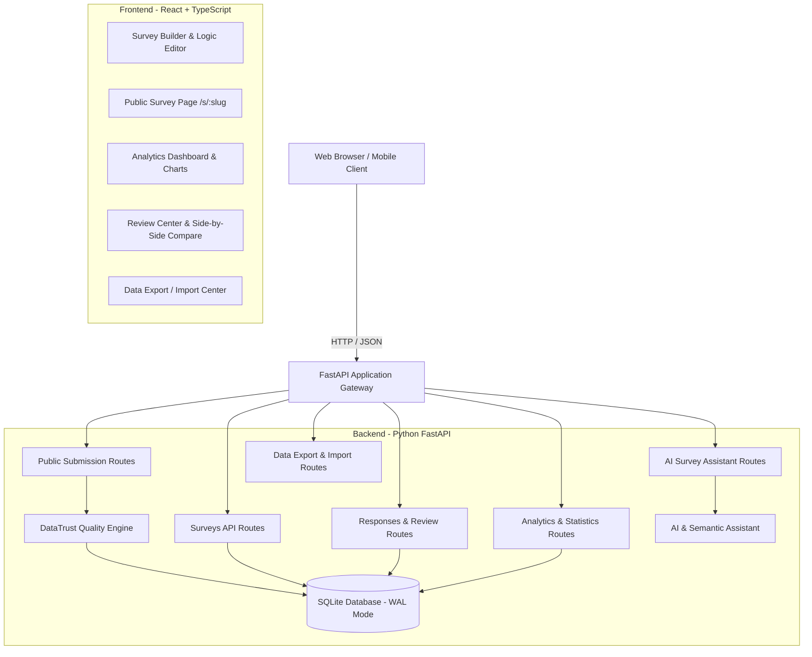

# DataTrust AI — Technical Architecture Specification

## 1. Kiến Trúc Tổng Thể (System Architecture Overview)

DataTrust AI tuân theo kiến trúc Clean Architecture tách lớp rõ ràng:
- **Presentation Layer (Frontend):** React 19 + TypeScript + Vite + Tailwind CSS + Lucide Icons + Recharts.
- **API & Application Layer (Backend):** Python FastAPI với RESTful API chuẩn, Pydantic v2 schemas, Dependency Injection.
- **Business Engine Layer:**
  - `QualityEngine`: Bộ phân tích chất lượng phản hồi đa tầng (Hamming distance vectorization, Shannon entropy, Straightlining analyzer, Cross-question logic validator, Timing anomaly detector).
  - `AIAssistant`: Module hỗ trợ soạn thảo khảo sát & phân tích ngữ nghĩa câu trả lời mở (Gemini / OpenAI / Fallback Deterministic NLP).
- **Persistence Layer (Database):** SQLite 3 (kích hoạt WAL Mode, Foreign Keys enforcement, Busy Timeout), thiết kế tương thích chuyển đổi PostgreSQL khi scale-up.

---

## 2. Phân Tách Trách Nhiệm Chi Tiết (Layer Breakdown)

### 2.1. Frontend Architecture
- **Router:** Quản lý các tuyến đường chính:
  - `/`: Bảng điều khiển tổng quan (Dashboard).
  - `/surveys`: Danh sách các cuộc khảo sát.
  - `/surveys/new`: Tạo khảo sát mới.
  - `/surveys/:id/edit`: Trình tạo & chỉnh sửa câu hỏi (Survey Builder).
  - `/surveys/:id/preview`: Xem trước khảo sát trên các kích thước màn hình.
  - `/surveys/:id/analytics`: Báo cáo phân tích chuyên sâu từng câu hỏi.
  - `/surveys/:id/responses`: Danh sách phản hồi & bộ lọc rủi ro.
  - `/surveys/:id/responses/:responseId`: Chi tiết phản hồi, cờ cảnh báo, quyết định xác minh.
  - `/surveys/:id/compare`: So sánh trực quan 2 phản hồi đối chiếu.
  - `/surveys/:id/export`: Xuất dữ liệu đa phạm vi (Raw, Reviewed, Verified Clean).
  - `/s/:slug` hoặc `/survey/:id`: Giao diện khảo sát công khai cho người tham gia.
  - `/submitted`: Màn hình cảm ơn và xác nhận ghi nhận phản hồi.

### 2.2. Backend Services & Quality Engine
- **Quality Engine Layers:**
  - **Layer A (Validation):** Kiểm tra bắt buộc, kiểu dữ liệu, giới hạn số lựa chọn.
  - **Layer B (Duplicate / Near-duplicate):** Chuẩn hóa vector câu trả lời đóng, tính khoảng cách Hamming, phát hiện tương đồng $\ge 90\%$.
  - **Layer C (Response Patterns):** Phân tích straightlining (chọn cùng 1 mức liên tiếp trên thang đo Likert), Shannon Entropy của phân phối đáp án, ma trận đáp án đơn điệu.
  - **Layer D (Logic Rules):** Thực thi các luật mâu thuẫn câu hỏi chéo (Ví dụ: "Không có con" nhưng câu sau lại chọn "Chi tiêu cho con > 5 triệu").
  - **Layer E (Speed & Frequency):** Đánh giá thời gian hoàn thành so với độ dài khảo sát ($T_{min} = \text{số câu hỏi} \times 2.5\text{s}$), phát hiện nộp bài dồn dập trong thời gian ngắn.
  - **Layer F (Text Repetition & Semantic):** Phát hiện chuỗi văn bản mở lặp lại hoặc vô nghĩa (gibberish).
  - **Layer G (Composite Risk Score):** Điểm rủi ro tổng hợp $0 \le \text{Risk} \le 100$ kèm lý do chi tiết (Explainable flags).

---

## 3. Chính Sách Bảo Mật & Độc Lập Môi Trường
- Backend lưu trữ file cơ sở dữ liệu `datatrust.db` cục bộ với cơ chế khóa an toàn.
- Cấu hình biến môi trường qua `.env` (ví dụ `PORT`, `DATABASE_URL`, `PUBLIC_BASE_URL`, `GEMINI_API_KEY`).
- Không để lộ thông tin nhạy cảm qua public endpoints: Endpoint `/api/public/surveys/:slug` chỉ trả về thông tin câu hỏi và tùy chọn cần thiết cho việc hiển thị, tuyệt đối không trả về ID người tạo hay dữ liệu phản hồi của người khác.
