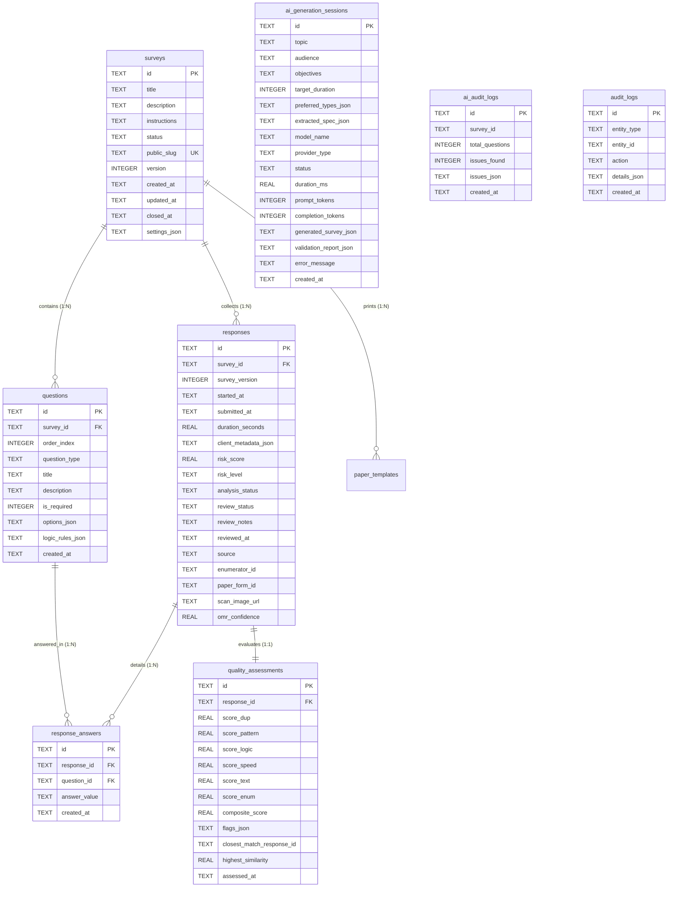

# DATATRUST — TÀI LIỆU THIẾT KẾ CƠ SỞ DỮ LIỆU & TOÀN VẸN DỮ LIỆU
**Mã tài liệu:** `DATATRUST-DB-2026-V1`  
**Hệ quản trị CSDL:** SQLite 3 (Chế độ Write-Ahead Logging - WAL Mode)  
**File lưu trữ:** `backend/data/datatrust.db`  

---

## 1. Nguyên Tắc Thiết Kế & Cấu Hình Vận Hành

DataTrust lựa chọn **SQLite 3 với chế độ WAL (Write-Ahead Logging)** làm cơ sở dữ liệu quan hệ cục bộ cho hệ thống:
- **Tách biệt Đọc/Ghi (Read/Write Concurrency):** Người đọc không chặn người ghi và người ghi không chặn người đọc. Các thao tác thu thập phản hồi diễn ra song song với các truy vấn báo cáo phân tích.
- **Toàn vẹn Dữ liệu (ACID Compliance):** Toàn bộ giao dịch đều được bọc trong `conn.commit()` và `conn.rollback()`.
- **Ràng buộc Khóa Ngoại (Foreign Keys Integrity):** Luôn thực thi `PRAGMA foreign_keys = ON;` khi mở kết nối. Khi xóa một cuộc khảo sát, toàn bộ câu hỏi, phản hồi, câu trả lời chi tiết và kết quả đánh giá chất lượng liên quan sẽ được tự động xóa theo (`ON DELETE CASCADE`).
- **Tối ưu Hiệu năng Đồng bộ:** Sử dụng `PRAGMA synchronous = NORMAL;` giúp tăng tốc độ ghi đĩa gấp nhiều lần mà vẫn bảo đảm an toàn chống hỏng dữ liệu trong trường hợp sập nguồn ứng dụng.

---

## 2. Sơ Đồ Thực Thể Quan Hệ (Entity-Relationship Diagram)



---

## 3. Đặc Tả Chi Tiết Các Bảng Thực Thể

### 3.1. Bảng `surveys` (Khảo sát)
- `id` (TEXT, PK): Khóa chính định dạng UUID.
- `title` (TEXT, NOT NULL): Tiêu đề khảo sát.
- `description` (TEXT): Mục tiêu, ngữ cảnh khảo sát.
- `instructions` (TEXT): Lời dặn dò người tham gia.
- `status` (TEXT): Trạng thái (`draft`, `published`, `closed`, `archived`).
- `public_slug` (TEXT, UNIQUE): Định danh slug trên URL công khai (`/s/:slug`).
- `version` (INTEGER): Phiên bản cấu trúc khảo sát (tăng dần khi sửa đổi câu hỏi).

### 3.2. Bảng `questions` (Câu hỏi)
- `id` (TEXT, PK): Mã định danh câu hỏi.
- `survey_id` (TEXT, FK): Liên kết bảng `surveys`.
- `order_index` (INTEGER): Thứ tự sắp xếp câu hỏi.
- `question_type` (TEXT): Một trong 12 dạng chuẩn (`single_choice`, `multiple_choice`, `short_text`, `long_text`, `number`, `rating`, `linear_scale`, `dropdown`, `date`, `likert`, `matrix`, `ranking`).
- `options_json` (TEXT): Chuỗi JSON chứa danh sách lựa chọn hoặc ma trận rows/columns.
- `logic_rules_json` (TEXT): Chuỗi JSON chứa điều kiện logic rẽ nhánh có điều kiện.

### 3.3. Bảng `responses` (Phản hồi thu thập)
- `id` (TEXT, PK): Khóa chính UUID của phản hồi.
- `survey_id` (TEXT, FK): Khảo sát được trả lời.
- `started_at` / `submitted_at` (TEXT, ISO 8601): Thời điểm mở form và gửi bài.
- `duration_seconds` (REAL): Tổng thời gian làm bài thực tế (dùng cho phát hiện Speeding).
- `risk_score` (REAL): Điểm rủi ro tổng hợp ($0.0 - 100.0$).
- `risk_level` (TEXT): Phân loại rủi ro (`low`, `medium`, `high`).
- `review_status` (TEXT): Trạng thái thẩm định (`unverified`, `under_review`, `verified_valid`, `verified_fraud`, `inconclusive`).
- `source` (TEXT): Kênh thu thập (`online_form`, `paper_scan`, `csv_import`).
- `enumerator_id` (TEXT): Mã định danh điều tra viên thực địa (nếu có).

### 3.4. Bảng `ai_generation_sessions` (Lịch sử sinh khảo sát AI)
- `id` (TEXT, PK): Mã phiên sinh AI (tiền tố `ai_gen_*`).
- `topic` (TEXT): Chủ đề người dùng yêu cầu.
- `audience` (TEXT): Đối tượng tham gia mong muốn.
- `objectives` (TEXT): Mục tiêu nghiên cứu hoặc giả thuyết.
- `preferred_types_json` (TEXT): Danh sách dạng câu hỏi ưu tiên dưới dạng JSON mảng.
- `extracted_spec_json` (TEXT): Bộ thông số kỹ thuật đã qua chuẩn hóa và khử khuẩn tiêm lệnh.
- `model_name` (TEXT): Tên mô hình thực tế xử lý (`gemini-2.5-flash`, `gemini-2.0-flash`, `Deterministic Archetype Engine`).
- `provider_type` (TEXT): Loại nguồn sinh (`gemini` hoặc `heuristic_fallback`).
- `status` (TEXT): Trạng thái hoàn thành (`completed`, `needs_review`, `repaired`, `failed`).
- `duration_ms` (REAL): Thời gian xử lý từ lúc nhận yêu cầu đến lúc hoàn tất kiểm định (mili-giây).
- `generated_survey_json` (TEXT): Toàn bộ cấu trúc bảng hỏi đã sinh.
- `validation_report_json` (TEXT): Chi tiết báo cáo kiểm định tính khách quan, điểm tuân thủ và danh sách cảnh báo.
- `created_at` (TEXT): Thời điểm ghi nhận.

### 3.5. Bảng `ai_audit_logs` (Nhật ký kiểm định câu hỏi)
- `id` (TEXT, PK): Mã lượt kiểm định (tiền tố `audit_*`).
- `survey_id` (TEXT): Khảo sát được rà soát.
- `total_questions` (INTEGER): Tổng số câu hỏi được quét.
- `issues_found` (INTEGER): Số lượng vấn đề phát hiện (dẫn dắt, câu hỏi kép, ma trận quá tải).
- `issues_json` (TEXT): Chi tiết từng lỗi kèm gợi ý tự sửa (`auto_fix_title`).
- `created_at` (TEXT): Thời điểm kiểm định.

---

## 4. Chỉ Mục Tối Ưu Truy Vấn (Indexes)

Hệ thống thiết lập 9 chỉ mục quan trọng nhằm tối ưu tốc độ đọc khi dữ liệu tăng trưởng:
1. `idx_surveys_slug`: Tìm kiếm khảo sát công khai theo `public_slug`.
2. `idx_questions_survey`: Tải danh sách câu hỏi theo `survey_id` và `order_index`.
3. `idx_responses_survey`: Truy vấn phân tích và danh sách phản hồi theo `survey_id` và `submitted_at`.
4. `idx_answers_response`: Truy xuất câu trả lời chi tiết theo `response_id`.
5. `idx_quality_response`: Lấy thông số đánh giá chất lượng theo `response_id`.
6. `idx_paper_templates_survey`: Tìm layout mẫu giấy OMR theo `survey_id`.
7. `idx_ai_gen_created`: Lọc lịch sử phiên sinh AI theo thời gian.
8. `idx_ai_gen_status`: Lọc phiên sinh AI theo trạng thái thành công/thất bại.
9. `idx_ai_audit_created`: Lọc nhật ký kiểm định theo thời gian.

---

## 5. Quy Trình Sao Lưu & Phục Hồi Dữ Liệu (Backup & Recovery)

Do SQLite ở chế độ WAL duy trì 3 tệp đĩa liên kết (`datatrust.db`, `datatrust.db-wal`, `datatrust.db-shm`), việc sao lưu phải tuân thủ chuẩn SQLite Online Backup:

### 5.1. Lệnh Sao lưu Trực tuyến (Zero-downtime Online Backup)
Sử dụng công cụ `sqlite3` CLI hoặc Python API để sao lưu an toàn mà không cần tắt ứng dụng:
```powershell
# Sao lưu an toàn bằng lệnh sqlite3
sqlite3 backend/data/datatrust.db ".backup 'backend/data/backup_datatrust_$(Get-Date -Format yyyyMMdd_HHmmss).db'"
```

### 5.2. Lệnh Phục hồi Dữ liệu (Restore Procedure)
1. Dừng tiến trình backend FastAPI.
2. Đổi tên tệp CSDL hiện tại để lưu trữ phòng ngừa.
3. Chép tệp backup về `backend/data/datatrust.db`.
4. Xóa tệp `-wal` và `-shm` cũ nếu có để khởi tạo lại chu trình WAL sạch.
5. Khởi động lại dịch vụ backend và chạy kiểm thử tự động `pytest`.
