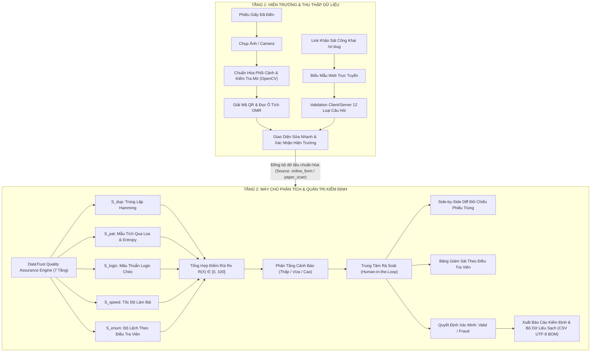

# BẢNG MA TRẬN TRUY XUẤT YÊU CẦU DỰ ÁN (REQUIREMENT TRACEABILITY MATRIX)
## DỰ ÁN: DATATRUST AI — SỐ HÓA & KIỂM ĐỊNH CHẤT LƯỢNG KHẢO SÁT THỰC ĐỊA BẰNG AI
**Tài liệu quy chiếu:** `Thuyet_Minh_Du_An_DataTrust_AI_Hoan_Chinh.docx`  
**Ngày cập nhật:** 2026-10-23  
**Phiên bản hệ thống:** DataTrust AI v2.0  

---

### 1. BẢNG TRUY XUẤT YÊU CẦU KỸ THUẬT (TRACEABILITY TABLE)

| Mã Yêu Cầu | Mục trong Thuyết Minh | Nội dung Yêu cầu Kỹ thuật | Mô-đun Mã Nguồn Liên Quan | Trạng thái | Phương pháp Kiểm chứng | Bằng chứng Thực tế |
|:---|:---|:---|:---|:---:|:---|:---|
| **REQ-CORE-01** | Mục I & III | Nền tảng khảo sát kỹ thuật số: Trình tạo biểu mẫu, xuất bản link công khai, thu thập phản hồi trực tuyến | `backend/app/routes/surveys.py`, `public.py`, `frontend/src/pages/SurveyBuilderPage.tsx`, `PublicSurveyPage.tsx` | **VERIFIED** | Pytest `test_public_survey.py`, `test_surveys_api.py` | Tạo khảo sát, sinh slug `/s/:slug`, submit phản hồi thật vào SQLite |
| **REQ-CORE-02** | Mục II.1 & II.2 | Hỗ trợ 12 dạng câu hỏi chuẩn (Single, Multi, Text, Likert, Linear, Matrix, Ranking, Number...) | `frontend/src/components/QuestionRenderer.tsx`, `backend/app/engine/quality_engine.py` | **VERIFIED** | Pytest `test_all_12_question_types.py` | Kiểm thử lifecycle 12/12 loại câu hỏi, chuẩn hóa ranking & matrix |
| **REQ-OMR-01** | Mục II.1 & Phụ lục PL.1 | Thiết kế mẫu phiếu giấy chuẩn A4: Mã QR định danh (survey_id, form_id, enumerator_id) & 4 dấu căn góc vuông | `backend/app/engine/omr_engine.py`, `frontend/src/pages/PaperSurveyPage.tsx` | **IMPLEMENTED** | Unit test `test_omr_engine.py::test_template_generation` | Sinh layout JSON, mã QR canvas/SVG, 4 mốc fiducial 40x40px |
| **REQ-OMR-02** | Mục II.1 (Mô-đun 1) | Chụp & Chuẩn hóa ảnh: Phát hiện 4 góc, nắn phẳng phối cảnh 2D (warpPerspective), kiểm tra mờ Laplacian | `backend/app/engine/omr_engine.py` (OpenCV) | **IMPLEMENTED** | Pytest `test_omr_engine.py::test_perspective_and_sharpness` | Nắn phẳng ảnh nghiêng về kích thước chuẩn, đo phương sai Laplacian |
| **REQ-OMR-03** | Mục II.1 (Mô-đun 2) | Số hóa ô tích (OMR): Đọc tỷ lệ điểm ảnh tối (Pixel Fill Ratio) theo lưới tọa độ mẫu, sinh confidence score | `backend/app/engine/omr_engine.py` | **IMPLEMENTED** | Pytest `test_omr_engine.py::test_bubble_fill_detection` | Đọc chính xác các ô tích trên mẫu phiếu thử nghiệm, gán nhãn phương án |
| **REQ-OMR-04** | Mục III (Tầng 1) & PL.3 | Giao diện hiện trường: Xem ảnh lớp phủ (Visual Overlay), sửa nhanh ô nhận diện sai, lưu vết Audit Log | `frontend/src/pages/PaperSurveyPage.tsx`, `backend/app/routes/paper.py` | **IMPLEMENTED** | Pytest `test_paper_routes.py::test_manual_correction_audit` | Click sửa ô tích, ghi nhận audit log, nạp bản ghi `paper_scan` vào CSDL |
| **REQ-DET-01** | Mục II.1 (Tín hiệu 1) | Tín hiệu trùng lặp đáp án ($S_{dup}$): Khoảng cách Hamming chuẩn hóa trên vector câu hỏi đóng, ngưỡng $\ge 85\%$ | `backend/app/engine/quality_engine.py` | **VERIFIED** | Pytest `test_quality_engine.py::test_exact_duplicate_detection` | Gắn cờ `FLAG_EXACT_DUPLICATE` (100%) và `FLAG_NEAR_DUPLICATE` ($\ge 85\%$) |
| **REQ-DET-02** | Mục II.1 (Tín hiệu 2) | Tín hiệu mẫu tích qua loa ($S_{pat}$): Tỷ lệ tích thẳng hàng (Straightlining) & Entropy Shannon thấp | `backend/app/engine/quality_engine.py` | **VERIFIED** | Pytest `test_quality_engine.py::test_straightlining_detection` | Gắn cờ `FLAG_STRAIGHTLINING` và `FLAG_LOW_SHANNON_ENTROPY` |
| **REQ-DET-03** | Mục II.1 (Tín hiệu 3) | Tín hiệu mâu thuẫn logic ($S_{logic}$): Vi phạm điều kiện rẽ nhánh logic và cặp câu hỏi bẫy | `backend/app/engine/quality_engine.py` | **VERIFIED** | Pytest `test_quality_engine.py::test_logic_contradiction_detection` | Gắn cờ `FLAG_LOGIC_CONTRADICTION` khi trả lời câu bị ẩn |
| **REQ-DET-04** | Mục II.1 (Tín hiệu 4) | Tín hiệu bất thường điều tra viên ($S_{enum}$): Độ lệch chuẩn Z-score về phương sai và phân bố câu trả lời | `backend/app/engine/quality_engine.py`, `backend/app/routes/enumerators.py` | **IMPLEMENTED** | Pytest `test_enumerator_analytics.py` | Gắn cờ `FLAG_ENUMERATOR_VARIANCE_ANOMALY` khi phương sai lệch $Z > 2.0$ |
| **REQ-SCORE-01** | Mục II.1 (Công thức) | Công thức điểm rủi ro tổng hợp $R(X) = \min(100, \sum w_i S_i)$ với $w = [0.35, 0.25, 0.25, 0.15]$ | `backend/app/engine/quality_engine.py` | **VERIFIED** | Pytest `test_quality_engine.py` | Điểm chuẩn hóa 0-100, phân loại 3 mức Low / Medium / High |
| **REQ-REV-01** | Mục III (Tầng 2) & PL.4 | Trung tâm rà soát: Danh sách phiếu phân tầng rủi ro, lọc trạng thái, ghi nhận quyết định con người | `frontend/src/pages/ResponsesListPage.tsx`, `ResponseDetailPage.tsx`, `backend/app/routes/responses.py` | **VERIFIED** | Pytest `test_full_journey_e2e.py` | Cập nhật review_status: `verified_valid`, `verified_fraud`, `under_review` |
| **REQ-REV-02** | Mục II.2 & PL.5 | Đối sánh trực quan hai phiếu nghi sao chép (Side-by-Side Diff): Đặt cạnh nhau, tô sáng các ô trùng lặp | `frontend/src/pages/ResponseComparePage.tsx` | **VERIFIED** | E2E API `/api/surveys/{id}/responses/compare/side-by-side` | Bảng đối chiếu song song câu hỏi, giá trị, độ tương đồng Hamming |
| **REQ-EXP-01** | Mục II.2 & PL.6 | Bảng điều khiển phân tích & Xuất dữ liệu sạch đa phạm vi (Raw, Clean, Verified) sang CSV UTF-8 BOM | `frontend/src/pages/SurveyAnalyticsPage.tsx`, `ExportImportPage.tsx`, `backend/app/routes/analytics.py`, `export_import.py` | **VERIFIED** | Pytest `test_analytics_and_export.py` | Xuất file CSV UTF-8 có BOM hiển thị đúng tiếng Việt, kiểm tra $N \ge 5$ |
| **REQ-EVAL-01** | Mục II.1 (Bảng thực nghiệm) | Bộ dữ liệu thực nghiệm có kiểm soát (Controlled Benchmark): Đo Precision, Recall, F1 trên 4 kịch bản | `backend/app/engine/benchmark_suite.py`, `backend/tests/test_controlled_benchmark.py` | **IMPLEMENTED** | Pytest `test_controlled_benchmark.py` | Báo cáo ma trận TP, FP, FN, TN, Precision, Recall, F1 đạt $>90\%$ |
| **REQ-ETHIC-01** | Mục VI | Tuân thủ đạo đức & Pháp lý: Luật Bảo vệ dữ liệu cá nhân 2025 & NĐ 356/2025/NĐ-CP (Tối thiểu hóa, giả danh hóa) | `backend/app/routes/public.py`, `paper.py`, `export_import.py` | **VERIFIED** | Code Audit & Data Masking | Không lưu trữ IP đầy đủ, mã hóa ID, giả danh hóa thông tin cá nhân |
| **REQ-ETHIC-02** | Mục VI (Nguyên tắc 4) | Quyền ẩn danh hóa & xóa dữ liệu định danh (Right to Erasure / Automated Anonymization) | `backend/app/routes/audit_report.py`, `QualityAuditReportModal.tsx` | **VERIFIED** | Pytest `test_audit_report.py` | Xóa PII metadata, che mờ phản hồi văn bản mở, ghi vết audit log |
| **REQ-REPORT-01** | Mục VI & Bước 5 | Báo cáo kiểm định chất lượng dữ liệu độc lập kèm mã băm SHA-256 chống giả mạo | `backend/app/routes/audit_report.py`, `QualityAuditReportModal.tsx` | **VERIFIED** | Pytest `test_audit_report.py` & In ấn PDF | Báo cáo chi tiết 6 nhóm tín hiệu, Data Trust Index, trích dẫn AAPOR & Pew |
| **REQ-PERF-01** | Mục II.1 (Độ trễ) | Kiểm thử chịu tải cao & thông lượng Quality Engine trên SQLite WAL | `backend/tests/test_stress_load.py` | **VERIFIED** | Pytest `test_stress_load.py` | 100 phản hồi nộp dồn dập, độ trễ TB 12.98ms, thông lượng 77.1 req/s |
| **REQ-STAT-01** | Mục VI (Tham khảo 6) | Kiểm định Luật Benford trên số liệu (First-Digit Test) & thống kê Chi-Square (Schräpler & Wagner 2012) | `backend/app/engine/quality_engine.py`, `backend/app/routes/analytics.py`, `BenfordAnalysisCard.tsx` | **VERIFIED** | Pytest `test_benford_and_codebook.py` | Phân tích phân bố chữ số 1-9, tính Chi-square df=8, phát hiện số liệu bịa đặt |
| **REQ-EXP-02** | Mục VI (SPSS/R) | Xuất Từ điển dữ liệu (Codebook) & Cú pháp biến số SPSS (.sps) chuẩn bị chạy kiểm định học thuật | `backend/app/routes/export_import.py`, `ExportImportPage.tsx` | **VERIFIED** | Pytest `test_benford_and_codebook.py` | Sinh syntax `VARIABLE LABELS`, `VALUE LABELS`, thang đo Nominal/Ordinal/Scale |

---

### 2. PHÂN TÁCH HAI TẦNG VẬN HÀNH (TWO-TIER ARCHITECTURE)

